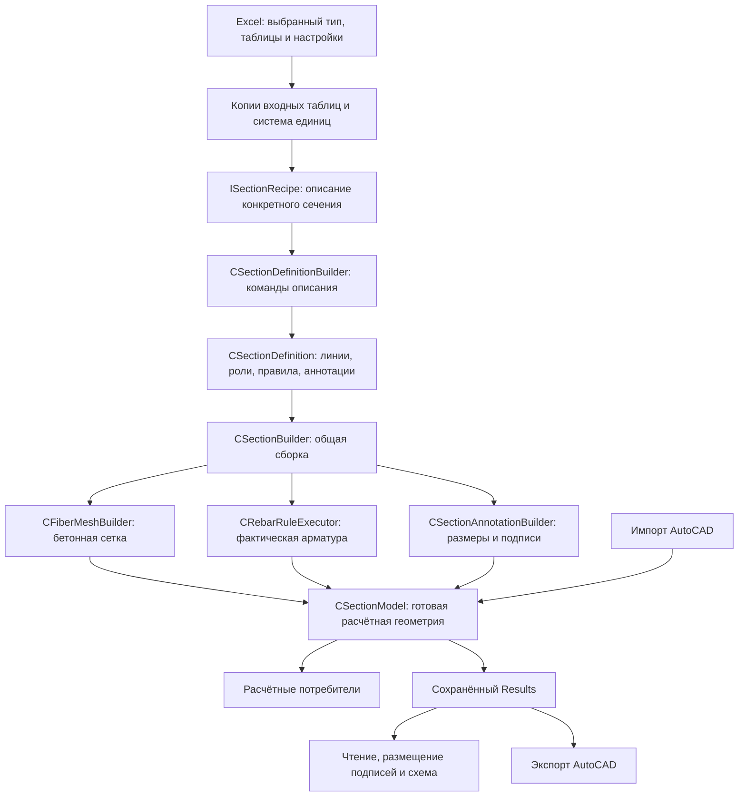

# Архитектура создания геометрии: аудит 13.10.2026

Проверен код коммита e2551c220d09330f788d931e967ac312df56bba1 и его опубликованная
книга. Рассмотрены обязанности, публичные контракты, зависимости и владение
объектами 37 классов: 26 классов Geometry/Section, десять классов интеграции и
учебный RoundedTrapezoid. Дополнительно проверены пять модулей интеграции и
общих структур данных. Полный состав, объявления методов и SHA256 исходников
сохранены в ArchitectureAudit.json.

Общий маршрут соответствует основной схеме ТЗ 1.4. Получение линии из фасада
и использование её имени в следующей команде не образуют круг. Однако назвать
все контракты строго разделёнными и неизменяемыми нельзя: воспроизведены две
проблемы владения состоянием; ещё три замечания относятся к устройству API и
распределению обязанностей. Рабочий код в рамках этого аудита не изменялся.

## Почему линия возвращается из фасада и затем используется им

В CSectionDefinitionBuilder есть закрытое поле mDefinition. Оно хранит описание
создаваемого сечения. RectanglePath выполняет две операции: общий геометрический
метод создаёт замкнутую линию, затем mDefinition.AddPath сохраняет её под именем.
Возвращаемый CGeometryPath — тот же зарегистрированный объект.

```vb
Set boundary = facade.RectanglePath("Boundary", 0#, 0#, 600#, 1000#)
facade.Outer "Concrete", boundary.ID

Set axis = facade.LinePath("TopAxis", 50#, 950#, 550#, 950#)
facade.RebarByCount "Top.Main", axis.ID, 5, 20#

Set definition = facade.Finish
```

В первой строке создаётся и сохраняется прямоугольная линия. Outer передаёт
строку "Boundary" и назначает уже существующей линии роль наружной границы
бетона. Он добавляет запись с ролью и ссылкой на линию, а не второй экземпляр
её геометрии. Сама замкнутая линия могла бы также служить вспомогательной фигурой
и не определять бетон — поэтому создание линии и назначение роли разделены.

TopAxis — другая линия, по которой должны располагаться центры стержней.
RebarByCount сохраняет правило «пять стержней диаметром 20 мм на этой линии».
Физические стержни создаются позже общим исполнителем. TopAxis автоматически
не становится бетонной границей.

Переменная boundary или axis является ссылкой на готовую линию. В старом примере
одна переменная path по очереди ссылалась на разные линии; это усложняло чтение,
но не удаляло ранее созданные линии из определения. Их сохраняет mDefinition.
Повторный AddPath для уже созданной фасадом линии отклоняется как дублирование ID.

Имена линий можно передавать прямо: facade.Outer "Concrete", "Boundary".
Возвращаемый объект удобен, когда нужны его ID, длина, именованные участки или
габариты. Он не хранит обратную ссылку на facade либо definition.

Декларативность здесь означает, что автор задаёт форму, роли и правила
размещения, а общие методы вычисляют нужную геометрию. Она не требует откладывать
все вычисления до Finish: линии и смещения уже строятся при соответствующих
командах, а сетка и физическая арматура — на следующем этапе.

Основание: CSectionDefinitionBuilder.RectanglePath:175, Outer:196,
PrepareRule:274, Finish:424; CSectionDefinition.AddPath:105, AddLoop:134,
AddRule:160, Path:81. Эксперимент подтвердил идентичность возвращённой и
зарегистрированной линии, отдельную роль бетонного контура и запрет повторного
добавления пути.

## Полный маршрут и границы обязанностей



Внутри CSectionBuilder текущий порядок: бетонная область, сетка, исполнение
арматурных правил, перенос элементов в CSectionModel, контуры, смысловые
аннотации. Сборщик координирует эти действия; собственной математики размещения
стержней или сетки в нём нет.

| Класс | Фактическая ответственность |
|---|---|
| ISectionRecipe | Один контракт CreateDefinition для любого параметрического типа. |
| CSectionRecipeCircle | Формат ввода Circle; окружность, оси, правила и размеры. |
| CSectionRecipeRectSet | Формат ввода и состав прямоугольников; правила для их граней. |
| CSectionRecipeRoundedRectangle | Вершины, радиусы, Simple/Tapered и выбор нужных участков. |
| CSectionRecipeHollowRectangle | Наружная граница, отверстие, грани и правила проекции рядов. |
| CSectionRecipeRoundedTrapezoid | Учебное расширение через тот же контракт, без изменения общих алгоритмов. |
| CSectionInputTable | Копия значений и адресов; общий поиск полей, проверки чисел и перевод единиц. |
| CSectionRecipeContext | Состав входных таблиц и доступ к единицам; ограничение A01 ниже. |
| CSectionDefinitionBuilder | Удобные команды заполнения определения; геометрическую математику вызывает у общих инструментов. |
| CSectionDefinition | Хранение определения, роли, ссылки, топология, зависимости правил и публикация. |
| CGeometryPath | Одна непрерывная линия из прямых и дуг; длина, участки, касательные, преобразования, происхождение сегментов. |
| CGeometryDiagnostic | Неизменяемая причина отказа с ID, численными деталями и источником. |
| CSectionGeometryQuery | Общие геометрические операции и подготовка области из модели; ограничение A05 ниже. |
| CConcreteRegion | Аналитические границы готовой области, роли петель, площадь и данные происхождения; Clone копирует геометрию. |
| CGeometryRegion | Подготовленная область для сетки и проверки центров стержней: габариты, центр и принадлежность точек. |
| CFiberMeshBuilder | Дискретизация бетонной области в расчётные элементы. |
| CRebarRuleOptions | Изменяемые входные параметры правила; фасад копирует их в определение. |
| CRebarRuleExecutor | Зависимости рядов, распределение по длине, проекции, смещения, совпадения, размещение и диагностика. |
| CRebarLayout | Фактические стержни, индексы и принадлежность группам; сейчас также хранит привязки подписей — A02. |
| CSectionModelBuilder | Перенос сетки и фактической арматуры в единый CSectionModel. |
| CSectionModel | Расчётные элементы, централизованные ID, контуры, аннотации и ревизия геометрии. |
| CSectionPropertiesCalculator | Механические A/I, приведённые характеристики и проекции по модели элементов; контроль ревизии снимка. |
| CSectionContours | Данные сохранённых Outer/Opening и их ревизия. |
| CSectionAnnotations | Данные размеров, подписей и других смысловых аннотаций, без построения исходного контура. |
| CSectionAnnotationBuilder | Разрешение геометрических привязок и размеров, аннотации параметрических и импортированных сечений. |
| CRebarGroupAnnotationBuilder | Текст количества и диаметров по фактическим стержням группы владельца. |
| CSectionTypeRegistry | Рецепты, их типы и имена таблиц; выбор через общий интерфейс. |
| CSectionInputSnapshotReader | Excel-адаптер: Value2 выбранных таблиц, копии значений и адресов. |
| CSystemSettingsReader | Общие настройки; разбор собственных таблиц типов находится в рецептах. |
| CUnitSystem | Централизованный перевод единиц и знаков; настройки объекта пока изменяемы. |
| CNDMResultsWriter | Сохранение готовых элементов, контуров и аннотаций в Results. |
| CSectionPlotDataReader | Чтение сохранённой геометрии и аннотаций; подготовка расстояния до фактической бетонной границы. |
| CPlotAnnotationLayout | Размещение подписей и размеров на схеме, перевод модельных координат в координаты изображения. |
| CSectionPlotter | Создание элементов диаграммы и фигур Excel из прочитанных данных и layout. |
| CAutoCADSectionModelImporter | Чтение CAD-объектов и заполнение той же модели; при пустом слое бетона вызывает общий построитель сетки. |
| CAutoCADContourReader | Чтение и проверка аналитических CAD-контуров, включая преобразование представления объектов. |

modWorkbookCalculation является точкой связывания Excel-ввода, реестра и общей
сборки. modAutoCADStressExport читает сохранённый Results и экспортирует модель;
он не вызывает рецепт. modSectionRecipeSetup обновляет ввод и список из реестра.
modGeometryTypes и modSectionRecipeTypes задают общие константы, структуры и
контракты ошибок. Структуры содержат значения и массивы, а не ссылки на Excel.

Импорт CAD является отдельным источником готовой геометрии. Это допустимая
граница: он сохраняет импортированную сетку, а не заставляет её снова проходить
параметрический рецепт. Общими остаются модель, геометрические операции,
создание сетки по контуру, сохранение и дальнейшие потребители.

## Что соответствует ООП и ТЗ

- **Инкапсуляция геометрии.** CGeometryPath после Seal запрещает дополнение.
  CSectionDefinition после Finish запрещает заполнение. Options и массив
  явных позиций скопированы; ConcreteDomain выдаётся глубокой копией. Проверено
  также изменение геометрии этой копии: исходная площадь не изменилась.
- **Разделение ввода, описания и исполнения.** Рецепты интерпретируют собственные
  поля, формируют вершины и описывают правила. Они не вычисляют координаты каждого
  стержня, не строят сетку и не создают Excel Shapes. Допустимые циклы описания
  граней и вершин остаются в рецептах.
- **Расширение новыми сечениями.** Один рецепт и одна регистрация достаточны для
  формы, выражаемой имеющимися примитивами. Проверка общих классов не обнаружила
  выбора по Circle/RectSet/RoundedRectangle/HollowRectangle. Новая геометрическая
  операция естественно требует изменения общей библиотеки; этот случай отличается
  от добавления нового сочетания уже имеющихся операций.
- **Единый интерфейс.** ISectionRecipe содержит один метод; штатные рецепты
  подставляются через него. Общий сборщик проверяет наличие опубликованного
  определения. Наследование отдельных классов каждой линии или каждого ряда
  для этого не требуется; композиция классов и структуры значений уместны.
- **Изоляция внешней среды.** В определении нет Workbook/Range и обратной ссылки
  на рецепт или reader. Solver получает готовые элементы. Схема и экспорт читают
  сохранённые результаты; настройки текущего ввода не пересоздают их геометрию.
- **Разные источники характеристик.** Аналитическая область и механические A/I
  сетки разделены. CSectionPropertiesCalculator считает по CSectionModel и
  проверяет модель/ревизию; площади контуров не подставлены вместо механических
  характеристик без явного решения.

Разделение ролей между facade, definition и общим builder обосновано.
Facade принимает команды, definition хранит данные и защищает их согласованность,
builder исполняет описание. Широкий набор команд facade сам по себе не означает
нарушение одной ответственности: его задача — описать одно сечение, а вычисления
и внешние операции отделены.

## Подтверждённые ограничения и порядок исправления

### A01 — контекст сохраняет изменяемые единицы по ссылке

CSectionRecipeContext.Initialize:23 выполняет Set mUnits = units; getter Units:48
возвращает этот же объект. Seal закрывает состав таблиц, но не состояние
CUnitSystem. InitializeDefaults:44 и LoadFromSettings:59 могут изменить его.

Контрпример: в закрытом контексте 100 см переводились в 1000 мм. После вызова
InitializeDefaults у внешнего units те же данные контекста дали 100 мм.
Табличные значения при этом сохранились. Штатные рецепты не перенастраивают
units; обнаруженное ограничение не доказывает ошибку их обычного расчёта.
Оно нарушает обещание неизменяемого ввода и создаёт зависимость от поведения
автора нового рецепта либо вызывающего кода.

Исправление должно находиться в CUnitSystem/CSectionRecipeContext: контекст
получает независимую копию настроек единиц и защищает её от перенастройки.
Одной копии в Initialize недостаточно, если getter затем возвращает её
изменяемой. Новый специализированный класс для каждого типа не нужен.

### A02 — построение аннотаций изменяет контейнер арматуры и сохраняет старые привязки

CSectionAnnotationBuilder.Build:23 очищает annotations, но затем добавляет
привязки в rebars через CRebarLayout.AddAnnotationAnchor:284. Старые привязки
при повторном Build не очищаются. CRebarGroupAnnotationBuilder:66 использует
первую подходящую привязку и исключает группу из дальнейшего вывода.

Эксперимент: два Build для одного layout увеличили число привязок с 1 до 2,
хотя итоговая подпись осталась одна. Затем новое определение с нормалью -1
применено к той же арматуре и исполненным правилам; все геометрические и
арматурные поля этих двух определений одинаковы. Фактическая нормаль подписи
осталась +1 из прежней привязки. Это воспроизведённый дефект повторного
использования публичного построителя, а не только стилистическое замечание.

Штатный CSectionBuilder создаёт новый layout на каждую сборку и вызывает
построитель аннотаций один раз. Поэтому приведённый повторный сценарий не
является его обычным маршрутом.

Правильная граница обязанностей: CRebarLayout хранит физические стержни и
их смысловую принадлежность; координаты привязок готовятся заново внутри
CSectionAnnotationBuilder и передаются форматировщику. Это можно сделать
в существующих классах через структуры/массивы, без новых рецептов и ветвей
по типам. Простое очищение привязок предотвращает накопление, но сохраняет
смешение двух обязанностей.

### A03 — axisDistance в командах подписей сейчас не используется для результата

Четыре Rebar*Label метода CSectionDefinitionBuilder:393–441 сохраняют
axisDistance во временной записи. Далее он попадает в
CRebarLayout.mAnnotationAxisDistance:306. Производственных чтений getter
AnnotationAxisDistance нет. CRebarGroupAnnotationBuilder.AddRebarLabels
не передаёт это значение в готовую аннотацию.

В тесте значения 50 и 5000 дали полностью одинаковые координаты, нормаль,
текст и значение готовой подписи. Реальный отступ определяется правильно
через сохранённый бетонный контур: CSectionPlotDataReader.AnnotationBoundaryDistance:1250
и CPlotAnnotationLayout.AddRebarLabel:241. Затем добавляется настройка плоттера.

Это относится именно к параметру команд подписей. as, использованный при
создании линии центров стержней, влияет на фактическую геометрию арматуры.
Лишний параметр подписей и его временное хранение стоит убрать из API,
потребителей и справочника, сохранив нынешнее вычисление от бетонной границы.

### A04 — проверка части арматурных условий запаздывает относительно сетки

Definition.Seal проверяет топологию, ссылки, зависимости и виды аннотаций.
Но ValidateOptions/Preflight принадлежат CRebarRuleExecutor. В эксперименте
ByMaxStep с нулевым шагом прошёл Finish и получил IsSealed=True. Исполнитель
правильно отклонил его с причиной «Шаг должен быть положительным».

CSectionBuilder.Build:30 создаёт сетку перед вызовом rules.Build:31.
Поэтому часть ошибочных правил выявляется после потенциально дорогой сетки.
Ошибочная арматура не публикуется, но описание «полностью проверенного»
определения неточно: проверки выполняются в нескольких фазах.

Улучшение — сохранить единственного владельца проверки арматурных правил
и выполнить его подготовку до построения сетки. Не нужно копировать
ValidateOptions в каждый рецепт либо создавать второй набор этих проверок.

### A05 — CSectionGeometryQuery совмещает геометрический движок и запрос к модели

В одном классе находятся операции над прямыми, дугами, областями и путями,
а также mSection, ревизия, кэш области и восстановление границ из расчётных
элементов (Initialize:153, EnsureDomain:1314, MeshBoundary:1395).
CGeometryPath для операций над сегментами создаёт CSectionGeometryQuery;
тот в свою очередь создаёт CGeometryPath. Статический граф содержит этот
взаимный классный контракт.

Это не круг владения и не бесконечная конструкция: query не хранит путь,
path не хранит facade/definition, создание query не создаёт новый path.
Но зависимость простого геометрического объекта от сервиса с контекстом
полной модели усложняет сопровождение и делает границы менее строгими.

ТЗ прямо требовало переиспользовать работающий query и не переписывать его
математику ради новой структуры. Поэтому это ограничение текущего разделения,
а не основание немедленно переделывать все алгоритмы. При дальнейшей работе
можно отделить операции над аналитическими сегментами от состояния модели,
сохранив единственную реализацию каждой формулы. Не требуется интерфейс или
класс на каждый примитив.

Сначала следует закрыть A01 и A02, затем убрать лишний параметр A03 и
уточнить порядок проверки A04. A05 требует самостоятельной оценки связей
и регрессии; его не нужно смешивать с небольшими исправлениями контрактов.
Условий по типам сечений ни одно из этих решений не требует.

## Дополнительные уточнения по контрактам

CSectionModel является изменяемой рабочей моделью с ревизией; это не тот же
объект, что неизменяемое CSectionDefinition. Изменения контуров учитываются
через CSectionModel.Revision:311. Геометрические и механические кэши проверяют
эту ревизию. Не следует описывать все возвращаемые объекты одним словом
«неизменяемые» — у разных стадий разные правила жизни.

CreateRecipe реестра возвращает уже зарегистрированный экземпляр, а не создаёт
новый при каждом вызове. Штатные рецепты не хранят изменяемое состояние сборки,
поэтому это безопасно. Название можно уточнить до GetRecipe при отдельной
чистке API; доказанного сбоя здесь не обнаружено.

Дополнительные memberships совпавшего стержня предназначены для происхождения.
Подпись использует группу опубликованного владельца; это ранее согласованное
решение пользователя. Отсутствие второго учёта углового стержня не признано
ошибкой. Независимые ряды одной группы учитываются по их фактическим стержням.

## Проверки и сохранность данных

На отдельной копии опубликованной книги выполнены семь направленных функций.
Внутри агрегированного RunCoreGeometryTests — пять самостоятельных наборов.

| Набор | Успешных проверок |
|---|---:|
| Аналитические пути | 276 |
| Именованные участки и привязки | 61 |
| Скруглённые многоугольники | 36 |
| Смещённые скруглённые линии | 27 |
| Табличные снимки | 45 |
| Определение, роли и копии | 15 |
| Общие правила армирования | 187 |
| Сетка у границ | 158 |
| Подписи фактической арматуры | 92 |
| Специальные проверки владения и защитных условий | 11 |
| Повторное построение подписей: контроль количества | 6 |
| Итого | 914 |

Все 914 защитных и регрессионных проверок успешны. Отдельные эксперименты
A01 и A02 выявили нарушения контрактов; они записаны как наблюдения и не
маскируются этой суммой. A03 и A04 также воспроизведены отдельно.
Ни успешные направленные проверки, ни статический аудит не заменяют полную
расчётную приёмку после будущих изменений этих контрактов.

Первый запуск скрипта остановился до VBA из-за присваивания Calculation в
пустом Excel. Порядок исправлен: рабочая копия открывается до переключения.
Этот запуск не считается проверкой кода приложения. Успешные запуски
выполнены на новых копиях. Полные on/off, solver-матрицы и UI/CAD-прогоны
в рамках архитектурного аудита не запускались.

Основная книга, ALL CODE и пользовательский execution_report побайтно
сохранены. Чужие процессы Excel/AutoCAD не закрывались. Удалённые компоненты
геометрии не обнаружены в актуальных src. Код не пересобирался для публикации,
поскольку изменений приложения нет.

Книга SHA256:
`80dbf11972c4990c75e8bd416ba56ab55333ad19a57fc5d845d4b819fdaa8c04`.
ALL CODE SHA256:
`3ed7f1834b6589c609fa78c0beddec046d3bde5c6cbe384ea5fdcd28b79b25ac`.
Доказательства: docs/regression/ExcelGuardGuide_2026-10-13/Architecture/;
ArchitectureAudit.json, RuntimeChecks.json, AnnotationRuntimeChecks.json,
исходник контрольного модуля и журналы функций.
